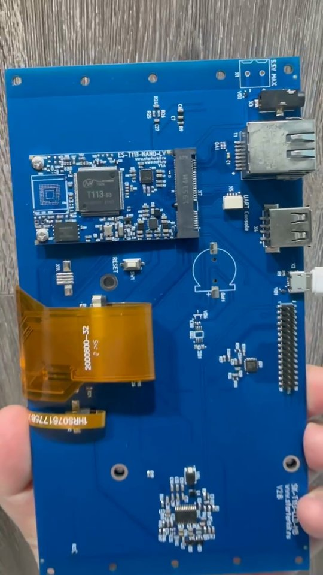
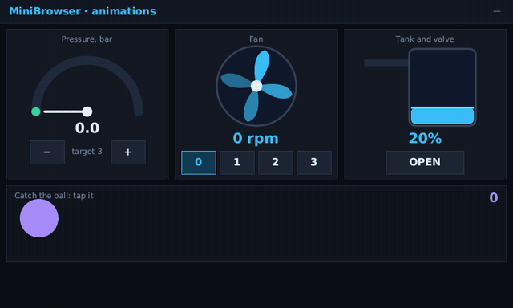
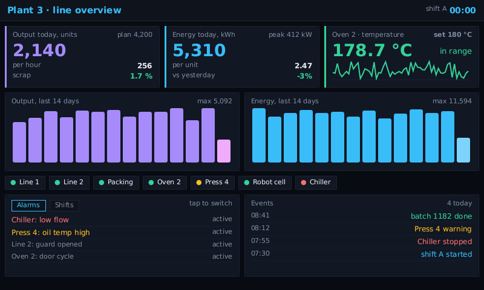
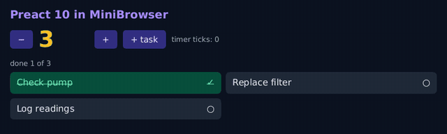
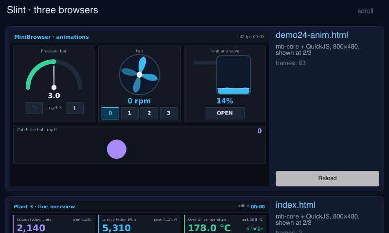
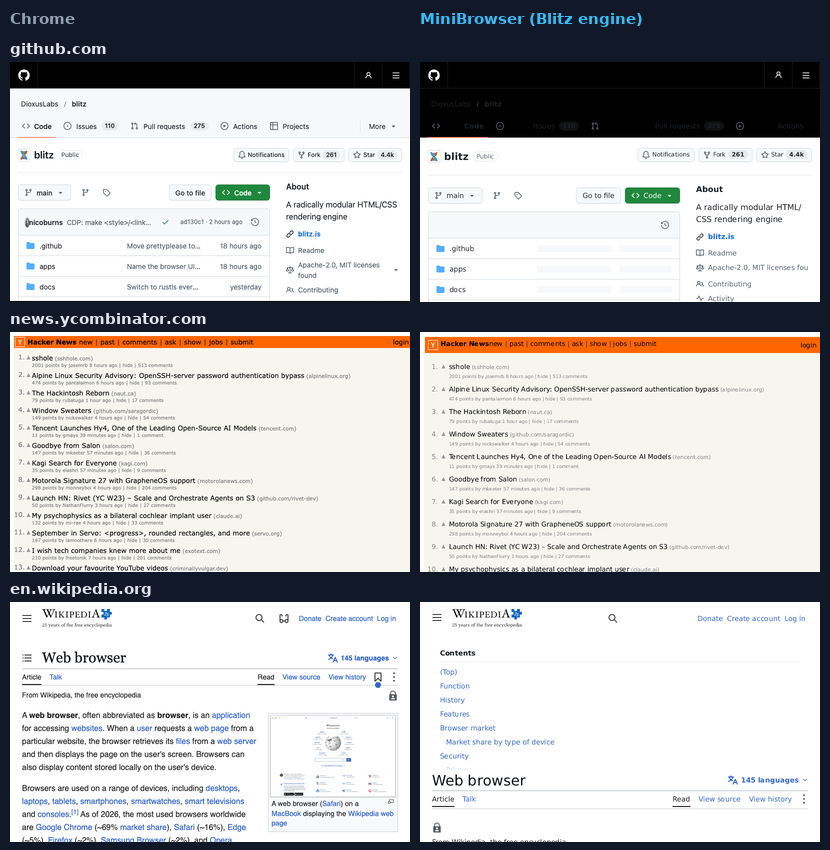
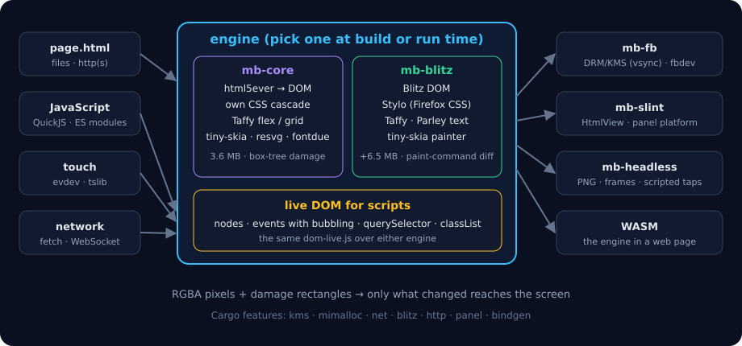

# MiniBrowser

**A small HTML/CSS/JavaScript engine for embedded Linux screens that have no
window manager, no GPU and not much memory.**

One static binary draws a web page straight to the display (DRM/KMS or
`/dev/fb0`) and reads the touchscreen (evdev, tslib calibration). No X11, no
Wayland, no Chromium. The same engine runs headless (page → PNG), in the
browser (WASM) and inside [Slint](https://slint.dev) apps.

<p align="center">
  
  
</p>

Built for and measured on an **Allwinner T113-S3** HMI panel: 2× Cortex-A7 at
1.2 GHz, 112 MB RAM, 128 MB NAND flash, 800×480 resistive touch, no GPU.

| on the T113 | |
|---|---|
| binary (armv7, static, musl) | **3.6 MB** (4.7 MB with networking) |
| memory, dashboard page | **12–25 MB** RSS |
| animation frame (gauges, fan, tank) | **~7 ms** (Blitz engine) / ~18 ms (core engine) |
| page load | 0.2–0.4 s |
| tap → handler → new frame | ~1–35 ms |
| idle CPU | 0% (nothing changes, nothing is drawn) |

## Why

Cheap Linux boards with a screen are everywhere: boiler rooms, machine tools,
kiosks, smart-home panels. Putting a UI on them usually means one of:

- **Chromium / WebKit (WPE)** — wants hundreds of MB of RAM, a GPU (WPE needs
  OpenGL ES) and more flash than the board has;
- **Qt / LVGL / Slint written by hand** — a native app for every screen, C or
  QML or a special language, a firmware build for every text change;
- **pictures drawn by a script** — no interaction, no layout.

Most of these screens are a few cards, gauges, buttons and lists — exactly what
HTML and CSS are good at, and what any web developer can write. MiniBrowser
makes that possible on hardware where a real browser does not fit.

### What sets it apart

- **Runs where browsers can't**: 32-bit ARM, ~100 MB RAM, no GPU, no window
  system. One file, no dependencies on the board — copy it and run it.
- **Draws only what changed**: frames are diffed (layout boxes in the core
  engine, recorded paint commands with Blitz) and only the damaged rectangles
  are repainted and sent to the screen. An idle page costs nothing.
- **Real web stack, not a widget toolkit with HTML-ish syntax**: html5ever,
  flex and grid layout (Taffy), a real DOM for scripts, ES modules, `fetch`,
  WebSocket; Preact runs unmodified.
- **Modular**: Cargo features switch parts on and off — networking, the Blitz
  engine (Firefox's CSS engine Stylo), DRM/KMS output, mimalloc — so a board
  gets only what it needs.
- **Embeddable**: the engine is a library with no platform code. Use it from
  Rust, inside a Slint UI (`HtmlView` element), headless for tests and
  screenshots, or as the ready-made `mb-fb` kiosk binary.
- **Measured against Chrome**: every demo page is rendered in headless Chrome
  and in MiniBrowser and compared pixel by pixel (`tools/refcompare.py`).

## Screenshots

| | |
|---|---|
|  |  |
| `www/dash/index.html` — a plant dashboard: cards, SVG charts, live data, tabs | Preact 10 + hooks, unmodified, on the live DOM; every tap is a real click event |
|  |  |
| A Slint app on the panel: a scrolling list of three live pages (`mb-slint`) | Real sites with the Blitz engine: Chrome (left) vs MiniBrowser (right) |

## Architecture

<p align="center"></p>

```
crates/mb-core      the engine: HTML (html5ever) → DOM → CSS → layout (Taffy) → RGBA pixels.
                    Page: scripts, timers, taps, scrolling, damage rectangles. No platform code;
                    JavaScript through the JsHost trait, a live DOM through the Dom trait.
crates/mb-qjs       JsHost on QuickJS: the DOM for scripts (dom.js, dom-live.js), timers,
                    ES modules, fetch/XHR/WebSocket on threads (feature `net`).
crates/mb-blitz     optional engine: Blitz (Stylo CSS from Firefox, Taffy, Parley text) painted
                    on the CPU by its own tiny-skia backend, with paint-command diffing.
crates/mb-fb        the kiosk binary and a library: DRM/KMS (double-buffered, vsync) or fbdev
                    output, evdev touch with tslib calibration.
crates/mb-slint     `HtmlView` for Slint, and a Slint platform for panels without a window system.
crates/mb-headless  page → PNG, with taps, timers and frame dumps (for tests and videos).
src/                the WASM build (the engine in a web page).
```

## Quick start

```bash
# Render a page to a PNG (macOS or Linux)
cargo build --release -p mb-headless --features net
./target/release/mb-headless www/demo/demo24-anim.html out.png --wait 2000 --click 640,252

# Tests
cargo test -p mb-core -p mb-qjs
```

### On a panel (armv7, static musl binary)

```bash
# rquickjs has no prebuilt bindings for armv7: they are generated (needs libclang).
LIBCLANG_PATH=/path/to/libclang \
cargo zigbuild --release -p mb-fb --features bindgen,net --target armv7-unknown-linux-musleabihf

# copy target/armv7-unknown-linux-musleabihf/release/mb-fb to the board, then:
./mb-fb /root/page.html                 # DRM/KMS if /dev/dri/card0, else /dev/fb0
./mb-fb page.html --engine blitz        # the Blitz engine (build with --features blitz)
MB_TRACE=1 ./mb-fb page.html            # per-frame timings
```

`mb-fb` reloads the page when its file changes: copy a new version over it.
`tools/S95minibrowser` is a sample init script for autostart.
Touch calibration comes from `/etc/pointercal` (tslib); `MB_TOUCH_CAL=a,b,c,d,e,f`
or `MB_TOUCH=swap,invx,invy` override it.

### Cargo features

| crate | feature | what it adds |
|---|---|---|
| mb-fb | `kms` (default) | DRM/KMS output with page flips; without it fbdev only |
| mb-fb | `mimalloc` (default) | mimalloc allocator (musl's malloc is slow) |
| mb-fb | `net` | fetch/XHR over http(s), WebSocket (+1.1 MB) |
| mb-fb | `blitz` | the Blitz engine next to the core one (`--engine blitz`, +6.5 MB) |
| mb-fb | `bindgen` | generate QuickJS bindings (needed for armv7) |
| mb-blitz | `http` | pages, images and stylesheets over http(s) |
| mb-slint | `panel` | Slint platform on mb-fb's screen and touch |

## Slint integration

`mb-slint` puts a live HTML page into a Slint UI as an ordinary element: Slint
draws the header and the buttons, the page below is HTML/CSS/JS, with its
timers and taps. It works on the desktop and on the panel itself, where
`mb_slint::panel` is a Slint platform drawn by Slint's software renderer onto
DRM/KMS or fbdev, with touch drags and taps — no window system, no libinput,
no fontconfig.

```slint
import { HtmlView } from "mb-slint/ui/html-view.slint";

export component App inherits Window {
    in property <image> page;
    callback page-tapped(float, float);
    VerticalLayout {
        Text { text: "Line 3"; }
        HtmlView { frame: root.page; tapped(x, y) => { root.page-tapped(x, y); } }
    }
}
```

```rust
let app = App::new()?;
let weak = app.as_weak();
let view = mb_slint::HtmlView::open("page.html".as_ref(), (800, 420), false, move |img| {
    if let Some(app) = weak.upgrade() { app.set_page(img); }
})?;
app.on_page_tapped(move |x, y| view.tap(x, y));
app.run()?;
```

Examples: `cargo run -p mb-slint --example dashboard`, the headless `snapshot`,
and `three` (three small browsers in a scrolling list, `--panel` on a board).

## Web platform support

✅ supported · 🟡 partial · ❌ not yet. "core" is the built-in engine, "Blitz"
the optional one (`--engine blitz`).

### HTML and DOM

| | core | Blitz |
|---|---|---|
| HTML5 parsing (html5ever), quirks mode | ✅ | ✅ (no quirks) |
| Real DOM for scripts: nodes, parent/children/siblings, create/append/insert/remove/clone | ✅ | ✅ |
| `getElementById`, `querySelector(All)`, `matches`, `closest` | ✅ (tag/class/id, descendant, child) | ✅ (all selectors) |
| attributes, `classList`, `dataset`, `style`, `innerHTML`/`outerHTML`, `textContent` | ✅ | ✅ |
| events: `addEventListener`, capture and bubbling, `onclick` attributes, `DOMContentLoaded`/`load` | ✅ | ✅ |
| `getBoundingClientRect`, `offsetWidth`… | ✅ | ✅ |
| `getComputedStyle` | 🟡 inline styles | ✅ |
| forms: text input with caret, focus | 🟡 | 🟡 |
| `` | 🟡 data: URIs (any URL in the WASM build) | ✅ files and http(s) |
| `<iframe>`, `<video>`, `<audio>` | ❌ | ❌ |

### CSS

| | core | Blitz |
|---|---|---|
| cascade, specificity, inheritance, `<style>` and inline | ✅ | ✅ (Stylo) |
| selectors: type, class, id, descendant, child, lists | ✅ | ✅ |
| pseudo-classes (`:first-child`, `:hover`…), attribute selectors, `+` `~` | ❌ | ✅ |
| box model, `box-sizing`, margins (collapsing), `min/max-*` | ✅ | ✅ |
| `display: block / inline / flex / grid / none` | ✅ (Taffy) | ✅ (Taffy) |
| `position: relative / absolute`, `top/right/bottom/left` | ✅ | ✅ (+ `fixed`, `sticky`) |
| borders per side, `border-radius`, `opacity`, `overflow: hidden` | ✅ | ✅ |
| units: px, %, em, rem | ✅ | ✅ (all, `calc()`, `var()`) |
| `@media`, custom properties, `calc()` | ❌ | ✅ |
| gradients, `box-shadow`, `transform` | ❌ | ✅ |
| transitions and animations | ❌ | 🟡 computed, not yet driven |
| fonts: `font-family` sans / serif / monospace, bold | ✅ (DejaVu built in, serif from the system) | ✅ (+ `@font-face`, web fonts) |
| text: `text-align`, `line-height`, `white-space`, wrapping | ✅ | ✅ (Parley, bidi) |
| `z-index` stacking | ❌ | ✅ |

### Graphics

| | core | Blitz |
|---|---|---|
| inline SVG (paths, arcs, gradients, transforms), changed live by scripts | ✅ (resvg) | ✅ |
| canvas 2D: rects, paths, arcs, text, transforms, `putImageData` | ✅ | ❌ |
| damage-rect repaint (only what changed) | ✅ | ✅ |

### JavaScript (QuickJS, ES2023)

| | |
|---|---|
| timers, `requestAnimationFrame`, `Date`, `Promise`, `async/await` | ✅ |
| ES modules: `<script type="module">`, `import`/`export` from files and http(s) | ✅ |
| `fetch`, `XMLHttpRequest` (files; http/https with `net`, on threads) | ✅ |
| `WebSocket` (`ws://`, with `net`) | ✅ (`wss://` ❌) |
| `localStorage`, `sessionStorage` (per run) | 🟡 not persisted |
| frameworks: Preact 10 + hooks | ✅ |
| import maps (bare `import 'x'`) | ❌ |

### Platform

| | |
|---|---|
| Linux DRM/KMS (double-buffered, vsync), fbdev | ✅ |
| touch: evdev taps and drags, tslib calibration | ✅ |
| keyboard input | 🟡 headless/WASM only |
| scrolling | 🟡 page scroll in core; not inside `overflow: auto` |
| headless PNG, frame dumps, scripted taps | ✅ |
| WASM in a browser | ✅ |
| Slint element and Slint panel platform | ✅ |

## Roadmap

- [x] Core engine: HTML, CSS cascade, flex/grid (Taffy), inline text, damage repaint
- [x] Native QuickJS host, timers, canvas 2D, inline SVG
- [x] Linux panels: fbdev, DRM/KMS with vsync, evdev touch, tslib calibration
- [x] Optional Blitz engine with a CPU tiny-skia painter and paint-command diffing
- [x] Real DOM for scripts on both engines; events with bubbling; Preact
- [x] ES modules; async `fetch`/XHR and WebSocket
- [x] Slint: `HtmlView` element and a panel platform without a window system
- [x] Fonts: sans / serif / monospace
- [ ] More selectors in the core engine: pseudo-classes, attributes, siblings
- [ ] `@media`, `calc()`, custom properties in the core engine
- [ ] CSS transitions and animations driven by the engine (both engines)
- [ ] Scrolling inside `overflow: auto` boxes, with touch drag and momentum
- [ ] Forms: on-screen keyboard, `select`, checkboxes, `input` events
- [ ] Canvas 2D on Blitz; `` from files and http(s) in the core engine
- [ ] `wss://` and persistent `localStorage`
- [ ] Hardware overlay plane for video and canvas (DRM planes)
- [ ] Prebuilt binaries for armv7 / aarch64 / x86_64, a C API (`mb_page_new`, `mb_page_tick`…)
- [ ] Smaller builds: more features behind flags, font subsetting tools

## Measuring against Chrome

`tools/refcompare.py` renders every page in `www/demo` in headless Chrome (with
the same DejaVu fonts) and in `mb-headless`, and counts the "ink" pixels (not
plain background in either image) that match within 2 px. The report is
`tests/ref/report.md`; `tools/sbs.py` makes a Chrome | MiniBrowser sheet.

## Licenses

MiniBrowser is MIT licensed (see `LICENSE`). It builds on html5ever, Taffy,
tiny-skia, resvg, fontdue and QuickJS (MIT/Apache-2.0); the optional Blitz
engine brings Stylo (MPL-2.0) and Parley; the bundled DejaVu fonts are under
the Bitstream Vera / DejaVu license; Slint (for `mb-slint`) is GPLv3,
royalty-free or commercial — choose for your product.
